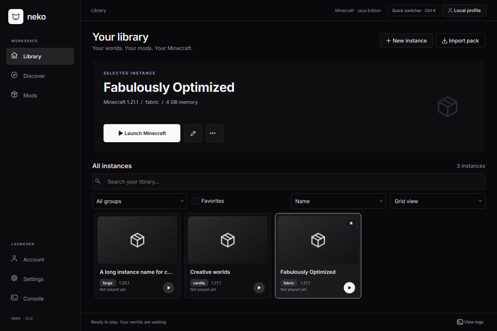

# Neko Launcher

A native Minecraft: Java Edition launcher written in **C++20**, **Qt 6 Widgets**, and **CMake**. No embedded web app. This is an initial working implementation, not a production-complete replacement for an established launcher.



## Build and run

Requires a C++20 compiler, CMake 3.24+, Qt 6.4+ (Widgets, Network, Concurrent and the WebP image plugin), libarchive headers/libraries, and QtKeychain for Qt 6. Install the Java runtime appropriate for the game separately.

```sh
cmake -S . -B build -DCMAKE_BUILD_TYPE=Release
cmake --build build --parallel
ctest --test-dir build --output-on-failure
./build/neko-launcher
```

Ubuntu/Debian development dependencies:

```sh
sudo apt install build-essential cmake qt6-base-dev qt6-image-formats-plugins libarchive-dev qtkeychain-qt6-dev
```

On NixOS: enter `nix-shell` using the included `shell.nix`, then run the build commands. Use a compiler and Qt from the same nixpkgs environment. An existing store-based validation build in this workspace is `build-verified/neko-launcher`.

On Windows, install Qt 6 and libarchive with a consistent MSVC or MinGW toolchain; pass the Qt install prefix and your dependency toolchain to CMake. On macOS, install Qt 6 and libarchive and add their prefixes to `CMAKE_PREFIX_PATH`. Only Linux has been compiled and smoke-tested here; Windows/macOS packaging is not provided.

## First launch

1. In **Settings**, set your default Java executable. In **My instances**, create an instance using the live Mojang version list, or import a `.mrpack` / CurseForge export ZIP.
2. In **Accounts**, choose an offline name or sign in with Microsoft. Offline play needs the game's files downloaded on an earlier connected launch; the first installation requires internet.
3. Configure instance memory and Java, then launch. The console shows downloads and live game output. Launching keeps the play screen visible; a Stop button is available while the game is running. Graphics backend failures open the console even when the game exits with code 0. Stop Minecraft from Settings, or close the game normally.

Microsoft sign-in uses the device-code → Xbox Live → XSTS → Minecraft token/profile flow. The public Microsoft application/client ID is built into Neko, so no setup is needed for the default registration. You can override it in Settings; a blank override uses the built-in ID. Custom registrations must support personal accounts, public-client/device authorization and the Minecraft API access required by Microsoft. No client secret or account token is embedded. The Minecraft session and Microsoft refresh token are saved using QtKeychain in the system credential store, with insecure fallback disabled. Expired sessions refresh automatically at launch. Sign out deletes the stored credential. Sign in once after upgrading from a session-only build. If the system vault is unavailable, the console reports the error and the account remains usable for the current session. The user confirmed sign-in works with the default registration.

CurseForge requires your own API key in Settings. It is stored in local Qt settings, not a secure credential vault. Modrinth browsing needs no key. If a mod disables third-party downloads, the imported instance is saved with a pending-files list. A completion dialog links to the exact official CurseForge file pages. Download those versions in your browser, then choose the files or check your Downloads folder. Neko verifies SHA-1 (or MD5 when that is all the API supplies), copies verified files into the instance, and blocks launch until all required downloads are present. Finish later and resume through the instance context menu or Launch. No CDN URL is guessed. If the pack archive itself is restricted, download its export ZIP through CurseForge and use Import pack.

## Installing individual mods

In **Discover → Mods**, select the destination instance. Search Modrinth or CurseForge; Minecraft version and loader are taken from that instance. **Mods → Browse mods** opens this view too. Vanilla instances need a mod loader first.

**Install mod** resolves the latest matching release and its declared required dependencies, then shows a review dialog before downloading. Optional dependencies are skipped. Modrinth dependencies pinned to specific releases are checked against the instance. CurseForge requires your API key; restricted files use the same verified browser-download completion flow as modpacks.

Downloads are staged and checksum-verified before new files are committed. Existing matching files are reused, differing files are preserved, disabled copies and conflicting managed releases stop installation, and cancellation rolls back newly committed files. The installer also checks top-level Fabric/Quilt/Forge/NeoForge mod IDs to catch duplicate mods with different filenames. Installation is disabled while Minecraft is running.

This is dependency resolution from provider metadata, not a complete mod compatibility solver. Mods added outside Neko can still conflict through version constraints, embedded dependencies, aliases or configuration. Changing a managed mod release requires removing its old file first; automatic updates and uninstall cascades are not implemented.

## Shared mod storage

Identical mod JAR contents are stored once under `shared/mods/sha256/` in Neko’s data directory. Instances use **read-only hard links**, so they keep normal files rather than symlinks that could dangle. Names, providers and version labels do not determine identity: sharing requires matching SHA-256 content. Different builds remain separate. Known SHA-1/SHA-512 downloads can reuse an existing verified object before contacting the provider.

Sharing applies to mod downloads, modpack imports/restores, manual CurseForge completion, local JAR additions and instance duplication. It includes disabled `.jar.disabled` files. Minecraft libraries and assets already live in launcher-wide directories. Worlds, configuration, logs and account data are never deduplicated by this feature.

In **Settings → Mod storage**:

- **Optimize existing mods** converts existing eligible files across instances. Run this once to reclaim existing duplicates.
- **Storage usage** reports shared files, duplicate content bytes saved, object data and unused object data. Savings exclude filesystem block rounding, compression and metadata overhead.
- **Clean unused shared files** removes only objects whose hard-link count proves there are no remaining file references. Stale checksum indexes are harmless cache misses.
- **Make selected instance’s mods private** creates writable independent copies and saves a per-instance preference for future imports. **Share selected instance’s mods** enables sharing again.

Neko writes downloads, archive overrides and private copies to new files before replacing an instance’s reference. Updating or deleting one instance therefore leaves the other references intact. Backups store full file contents and can be restored without the shared directory. Do not force shared files writable and edit them in place with external tools: hard links share the same underlying file. Make the instance’s mods private first if you need to edit a JAR.

Storage changes are blocked while Neko’s game process is running, run off the UI thread and support cancellation. Optimization can leave a valid partially optimized library when cancelled; it is safe to retry. Interrupted private conversion keeps the privacy preference, and can be retried to finish. Filesystems or volumes without hard-link support retain ordinary copies and report no deduplication savings. Linux behavior is tested; Windows/macOS runtime behavior has not been verified.

## Visual design

The play screen uses official project artwork for modpacks installed through Discover. Modrinth featured gallery images are preferred, with the project icon as fallback; CurseForge uses the official project logo. Other instances use a native geometric placeholder. For an existing imported pack, right-click → **Use official Modrinth artwork…** and enter its project URL or slug. Custom local covers remain available. No generated landscape is bundled.

The interface now uses shadcn-inspired neutral dark/light palettes, compact navigation, outlined controls, restrained corner radii and segmented content tabs. The first launch after this redesign selects Shadcn Dark; Catppuccin and custom styles remain available in Settings. The library has a dedicated header, a cinematic official-artwork panel, spacious instance cards with loader/version badges and last-played details, functional per-card play controls, and filters that rearrange into two columns on narrow windows. Discover shows official project icons and download counts, loaded asynchronously and cached locally. Accounts have a profile card and Settings are organized into separate sections. The sidebar adapts to a compact rail, while animated navigation and optional page fades respect a Reduce Motion setting. Typography, groups/favorites, custom QSS, text sizes, and all four Catppuccin flavors remain supported. Demo screenshots contain test instances, not bundled packs.

## Everyday tools

Press **Ctrl+K** to search instances, pages and actions with the keyboard. The selected instance’s **…** menu also provides:

- **Check instance health**: checks Java availability, memory settings, pending downloads, cached game files and free disk space, with a copyable report. This does not resolve mod dependencies.
- **World snapshots**: create saves-only restore points, or opt into snapshots before launch. Automatic retention is configurable; manual and recovery snapshots are preserved. Restore requires Minecraft to be closed, verifies the archive, stages replacement saves and first saves a recovery copy. Snapshots live beside instances in the launcher data directory; copy them elsewhere for protection against disk loss.
- **Session history**: local playtime, the last 100 completed sessions, and exit results. Lifetime totals survive history trimming. Failed process starts do not count as sessions. No account tokens or full command lines are stored in history.

## Included

- Isolated instances with persistent JSON configuration, grid/list views, search, groups, favorites, name/recent/favorite sorting, per-tile colors, duplicate/delete, folder shortcuts, and live logs.
- Right-click instance actions, local `.neko.zip` backup/restore (including saves and mods), and keyboard shortcuts: Ctrl+N new, Ctrl+I import, Ctrl+E edit, Ctrl+L search, Enter launch. Restore a backup through Import pack; it receives a new instance ID.
- Tabbed instance editor: overview/components, runtime/environment, mods, resource packs, shaders, worlds, logs and crash reports. File tabs apply additions/toggles immediately; Save applies configuration fields.
- Mojang's complete published version catalog, modern argument/rule evaluation and legacy `minecraftArguments`, assets, asset maps, libraries, native ZIP extraction, and logging configuration.
- Vanilla, Fabric, Quilt, Forge and NeoForge installation. Loader versions can be pinned per instance; the resolved loader profile is cached for offline reuse.
- Microsoft device-code login with entitlement/profile checks, plus explicit local/offline profiles with Java-compatible offline UUIDs.
- Modrinth and CurseForge modpack search, project links, latest-pack download, and local import. Imports support client overrides and integrity hashes. Fatal import errors roll back the new instance; browser downloads leave a saved, resumable instance.
- Enable/disable local `.jar` mods and add mod files.
- Catppuccin Mocha, Macchiato, Frappé and Latte plus the original four palettes, interface font sizes, custom Qt stylesheets, and an advanced JSON editor. The library uses a compact navigation rail, an official-artwork launch banner and scrollable pages; instance names elide with full-text tooltips.
- Per-instance Java executable, initial/maximum RAM, JVM arguments, game arguments, resolution, and loader version. The advanced editor also accepts a complete compatible Fabric/Quilt-style loader `profile` object.
- HTTPS-only requests, verified hashes when supplied by upstream metadata, atomic file writes, ZIP traversal/link rejection, extraction-size limits, and token redaction from displayed/exported logs.

## NixOS graphics and audio libraries

The game process automatically includes `/run/opengl-driver/lib` in its library search path on NixOS, preserving inherited paths. Native working directories (`java`, `jna`, `lwjgl`, `netty`) are created for newer Minecraft metadata. The included Nix development shell also supplies OpenGL, Vulkan, OpenAL, SDL and Wayland loader paths. You can add further directories in **Edit instance → Runtime → Native library paths**, or set per-instance environment variables. This build also includes the installed Vulkan loader directory in the game environment when found at build time (`NEKO_VULKAN_LIBRARY` in CMake). Both LWJGL OpenGL and Vulkan initializers have been verified with the installed Java 25 and cached game libraries. The build also discovers Wayland, xkbcommon and other SDL runtime library directories and passes them to the game process. On NixOS it supplies EGL vendor/external-platform discovery directories if unset. The exact SDL3 library from the supplied modpack successfully created a hidden OpenGL 3.3 window/context with these paths; without Wayland runtime paths the same probe failed. The supplied game log shows OpenGL `EGL_BAD_DISPLAY`, then Iris aborting after Vulkan fallback. The launcher recognizes and explains this failure. In **Edit instance → Runtime → Linux display backend**, you can explicitly try X11/XWayland or Wayland. Automatic preserves the desktop session's defaults. A complete modpack game launch has not been performed after the change; the successful hidden SDL window/context probe is the current validation.

## Compatibility and current limits

**A catalog entry is not a compatibility guarantee.** Modern and legacy launch plans are covered by deterministic tests, but real game launches across the catalog have not been tested. Old alpha/beta builds, unusual assets/layouts, unsupported OS/CPU natives, and future metadata may require additional handling. The launcher targets Java Edition, not Bedrock.

Forge and NeoForge packs retain their pinned loader versions. On first launch Neko downloads the official installer with SHA-1 verification and runs its client installation inside Neko's own data directory. The installer handles processors and patched libraries; its generated version profile is cached. Verified with Forge 47.4.0 / Minecraft 1.20.1 and NeoForge 21.1.172 / 1.21.1, including launch argument/library resolution. This does not establish compatibility with every historical installer or modpack. Older installers without headless client support can fail with a diagnostic. Manually created NeoForge instances currently require a pinned loader version. No complete Forge/NeoForge game session has been tested.

Java selection is automatic by default. Before launch, Neko checks the Minecraft metadata requirement and uses a matching installed runtime, checking the preferred executable, JAVA_HOME, common JDK directories, instance-data `runtimes/`, and Nix store installations. This handles an older `java` on PATH while a suitable JDK is already installed. Modern quoted/unquoted and legacy Java version output are supported. Instance Runtime settings provide **Detect compatible Java**, an automatic-selection toggle, a preferred executable and the last-used executable. When automatic selection is disabled, the selected executable is checked against the metadata minimum. Missing matching installations produce an actionable error. Runtime downloads are not implemented. Pack updates/export, skins, and multiple saved accounts are not implemented. Mod installation resolves required provider dependencies; it does not solve arbitrary mod compatibility or update existing unmanaged mods.

Discover provides search as you type, relevance/downloads/updated/newest sorting, 20-result pagination, and an editable Minecraft version filter populated from Modrinth’s version catalog. Modrinth additionally supports loader and category filters. Searches cancel superseded requests and ignore stale responses, with inline loading, empty and error states. Official result cards show author, summary, downloads and categories. Filters sit beside results on wide windows and collapse behind a Filters button on small windows. Entering Discover browses packs immediately. Filtered installs request a matching game-version/loader release; otherwise they install the latest returned published version. There is no individual pack-release picker yet. Modrinth optional client files are included. Restricted CurseForge mod downloads require the browser-download completion step. Network work runs off the GUI thread and can be cancelled from the footer. Cancellation is checked during requests, asset verification and sign-in polling; archive extraction finishes its current operation before cancellation is observed. Downloads have a 512 MiB per-file memory limit; archive extraction is limited to 2 GiB per entry and 8 GiB total. Cached hashless loader artifacts are reused without re-verification.

Configuration uses `QSettings`. Game data uses Qt's platform application-data directory; the exact location is visible in Settings. User-provided arguments and stylesheet/JSON edits are intentionally powerful local customization controls.

## Source map and validation

- `src/core/`: HTTP, metadata, authentication, loaders, runtime selection, archives and modpack imports, separated by responsibility.
- `src/window.*`: desktop shell and shared UI state; `src/ui/` contains individual pages, process handling and instance tools.
- `src/instance_services.*`: health checks, recoverable world snapshots, session records and command matching, independently testable without a GUI.
- `src/cards.*` and `src/design.*`: native cards, artwork, icon drawing and navigation.
- `tests/`: deterministic core and instance-service suites, plus optional secure-vault checks.

See [Architecture and contributor guide](docs/ARCHITECTURE.md) for ownership boundaries, data formats and verification commands.

Optional live service validation: `./build/core-tests --network` checks Mojang metadata, Fabric/Quilt profiles and Modrinth search. It also downloads the Fabric loader libraries into a temporary fixture and confirms the classpath JAR contains `KnotClient.class`. It does not download a game or sign into an account. `./build/core-tests --loader-integration` downloads and runs the two official loader installers in temporary directories and validates their launch plans (requires Java 21+, or set `NEKO_TEST_JAVA`). `./build/keychain-tests` tests secure write/read/delete with a synthetic credential under a unique test service, without reading launcher credentials; run it in a desktop session with a credential-store backend.

Run `QT_QPA_PLATFORM=offscreen ./build/neko-launcher --smoke-test` for a headless GUI smoke test that writes `neko-preview.png` and exits. It does not launch Minecraft. To isolate settings/data while testing, set `XDG_CONFIG_HOME` and `XDG_DATA_HOME` on Linux.

Service references: [Microsoft device authorization](https://learn.microsoft.com/en-us/entra/identity-platform/v2-oauth2-device-code), [Modrinth API](https://docs.modrinth.com/api/), [Modrinth pack specification](https://support.modrinth.com/en/articles/8802351-modrinth-modpack-format-mrpack), [CurseForge API](https://docs.curseforge.com/rest-api/).

This project is not affiliated with Mojang, Microsoft, Modrinth, or CurseForge. Minecraft itself and service credentials are not distributed here.

Layout regression check: run `QT_QPA_PLATFORM=offscreen XDG_CONFIG_HOME=/tmp/neko-layout-config XDG_DATA_HOME=/tmp/neko-layout-data ./build/neko-launcher --ui-test`. This visits all six pages at four window sizes and two font sizes, checks wrapped labels for clipping, across all four Catppuccin flavors plus Shadcn Dark/Light, and saves 288 page previews plus editor-tab previews under `build-verified/ui-previews`. Use isolated settings as shown because this diagnostic changes interface settings.

Design references: [XMCL](https://xmcl.app/en/) for the rail/library/banner composition, [Prism Launcher](https://prismlauncher.org/wiki/) for instance-oriented organization, [Feather](https://feathermc.com/a/) and [Lunar Client](https://www.lunarclient.com/news/how-to-use-the-new-lunar-client-launcher) for the cinematic play screen and restrained controls, and the [official Catppuccin palette](https://catppuccin.com/palette/) for all four flavors. Neko remains its own implementation and does not claim full Prism feature parity.

Runtime-selection validation: `./build/core-tests --java-integration` verifies that an installed Java 25 is found despite the default PATH runtime. The deterministic suite covers modern, legacy and unquoted version output.

Manual-download checks cover exact official file URLs, unsafe paths, missing hashes, wrong-version rejection, renamed browser downloads, resume after restart, canonical file placement, MD5 fallback and launch blocking. UI checks include the completion dialog.

The UI diagnostic also checks inline card play hit targets and the manual-download dialog. When an isolated data directory contains `cache/ui-search.json` with public Modrinth search results, it renders those records in Discover. Add `--network` to the UI diagnostic to verify asynchronous official-thumbnail downloads; ordinary layout checks avoid network requests.

Instance-service tests cover snapshot isolation, integrity, recovery, cancellation, retention, session history limits and lifetime totals. The UI diagnostic also checks command selection, real short-lived child process callbacks, and the health, snapshots and history dialogs. It never starts Minecraft.

Search integration check: `./build/core-tests --search-integration` verifies live Modrinth version/loader/category facets, download sorting, pagination and empty results. It downloads no pack or game files. CurseForge filtering requires an API key and has not been live-tested here.

`./build/mod-install-tests` checks dependency graphs, compatibility rejection, staging, cancellation rollback, existing-file protection and restricted-download completion. Add `--network` to search, resolve and install Mod Menu into a temporary Fabric instance using the public Modrinth API, without launching Minecraft. CurseForge is covered with offline provider fixtures; no live CurseForge key was used.

NeoForge BootstrapLauncher profiles now include the original client JAR filename in `ignoreList`, preventing the vanilla client from becoming a duplicate module alongside patched Minecraft. A deterministic launch-plan test covers the different base/profile filenames. A full game run with the supplied pack has not been performed.

`./build/mod-storage-tests` verifies shared file identity, checksum cache reuse, build separation, disabled files, deletion safety, independent backups, atomic replacement, private conversion, unsupported-link fallback, cancellation and symlink rejection using temporary data. No user instances are modified by these tests.

The Linux game environment also includes configured PipeWire, PulseAudio and ALSA client library directories. `shell.nix` supplies these dependencies, and CMake discovers their directories with the other native libraries. This fixes the supplied log’s `Failed to open OpenAL device` / disabled-sounds failure: the same bundled OpenAL library failed to load all three backends with the inherited environment and successfully opened the default PipeWire device with Neko’s environment. No game or audible playback was used for that test. Restart Minecraft after updating the launcher; its already-failed sound engine will not inherit new paths.

**Edit instance → Runtime → Linux audio backend** provides Automatic, PipeWire, PulseAudio and ALSA. Automatic preserves existing OpenAL configuration. Explicit choices use OpenAL Soft’s documented [`ALSOFT_DRIVERS` override](https://github.com/kcat/openal-soft/blob/master/docs/env-vars.txt). In-game volume and output-device preferences are preserved.

Optional desktop audio diagnostic: `./build/audio-tests /absolute/path/to/instance/natives/libopenal.so` compares inherited and launcher environments by opening and closing the default output device. It plays no sound and needs access to the user’s desktop audio socket; it is not part of unattended CTest.
